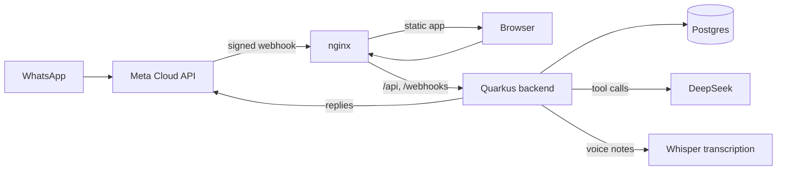

<div align="center">
  

# beFree

**A personal finance app you talk to. Send a text, a receipt photo, a voice note or a PDF statement, and it lands in your ledger.**

[](https://github.com/AndDev741/beFree/actions/workflows/ci.yml)

</div>

beFree keeps one person's money in order. You tell it what you spent over WhatsApp or in the app's chat, and an AI assistant writes it to a ledger that you also see on a web dashboard. The dashboard shows where the month went, how each budget is doing and how far along your savings goals are.

The assistant touches your data through a fixed set of tools: record, list, edit, summarise, budgets and goals. Every number it quotes comes from the database.

```text
you      3 café
beFree   ✅ #52 3.00 EUR café (Food)
```

> [!NOTE]
> The interface is in Portuguese. The assistant answers in the language you write in.

## Features

- **Chat to record.** "50 lidl e 12 gasolina" becomes two transactions. When an amount is missing, the assistant asks one short question.
- **Photos, voice notes and PDFs.** Receipt photos go to a vision model and voice notes to a transcription service, and the assistant treats the result as your message. A PDF statement is summarised first and imported only after you say yes. Rows that already exist, matched by date and amount, are skipped.
- **One conversation.** WhatsApp and the in-app chat share a thread, so "apaga o último" works from either.
- **Budgets.** A monthly limit per category, checked against the month's transactions when you ask.
- **Savings goals.** Money set aside for later, with an opening balance, a target date and the monthly amount to put aside. An expense can come out of a goal's jar and stays out of the month's spending.
- **Months that start when yours does.** The month begins on any day from 1 to 28, with an exception for a single month when pay day slips.
- **Single owner, locked down.** One account with a bcrypt hash and a 14-day session cookie. The WhatsApp webhook checks Meta's HMAC signature, answers only numbers on an allow-list and handles each message once, even when Meta redelivers it.

## How it fits together



Meta delivers each WhatsApp message to the webhook. The backend acknowledges it at once and runs the assistant on a virtual thread, so a slow model call never triggers a redelivery. The chat model is DeepSeek through LangChain4j's OpenAI-compatible client. Voice notes go to any OpenAI-compatible transcription endpoint, Groq Whisper by default.

## Quick start

You need JDK 25, Docker (Quarkus Dev Services starts Postgres) and Node 22.

```sh
# terminal 1
cd backend
./mvnw quarkus:dev
```

```sh
# terminal 2
cd frontend
npm install
npm run dev
```

Open http://localhost:5173 and sign in as `andre` with the password `befree-dev`. `vite dev` proxies `/api` to the backend on port 8080, so the session cookie behaves as it does in production.

> [!TIP]
> The assistant stays off until it has a key, and chat replies with a configuration notice. To turn it on, start the backend with `QUARKUS_LANGCHAIN4J_OPENAI_API_KEY=<your DeepSeek key> ./mvnw quarkus:dev`. Voice notes need `BEFREE_TRANSCRIPTION_API_KEY` as well.

## Configuration

Production reads its settings from the environment.

| Variable | What |
|---|---|
| `QUARKUS_DATASOURCE_JDBC_URL`, `QUARKUS_DATASOURCE_USERNAME`, `QUARKUS_DATASOURCE_PASSWORD` | The Postgres connection. Flyway creates the schema at start |
| `BEFREE_PASSWORD` | Password of the owner account, hashed with bcrypt on first start. Without it and without an account, nobody can sign in |
| `BEFREE_SESSION_KEY` | Encrypts the session cookie. Keep it stable, or every restart signs you out |
| `QUARKUS_LANGCHAIN4J_OPENAI_API_KEY` | DeepSeek API key. The assistant stays off until it is set |
| `BEFREE_TRANSCRIPTION_API_KEY` | Key for the transcription endpoint. Voice notes stay off until it is set |
| `WHATSAPP_ACCESS_TOKEN`, `WHATSAPP_PHONE_NUMBER_ID` | Send replies through the Graph API |
| `WHATSAPP_VERIFY_TOKEN` | Answers Meta's one-time webhook verification |
| `WHATSAPP_APP_SECRET` | Checks the webhook signature. A call without a valid one gets 401 |
| `WHATSAPP_ALLOWED_PHONES` | Comma-separated senders the assistant answers, in international format without the `+`. Everyone else gets silence |

`befree.zone` sets the time zone for "today" in chat and for dates without a year. It defaults to `Europe/Lisbon`.

Point the Meta webhook at `/webhooks/whatsapp`.

## Repository layout

| Folder | What | Stack |
|---|---|---|
| [`backend/`](backend) | REST API, assistant, WhatsApp webhook and the Flyway schema | Quarkus 3 on Java 25, Hibernate Panache, Postgres, LangChain4j |
| [`frontend/`](frontend) | The dashboard and the in-app chat | React 19, Vite, TypeScript |
| [`deploy/`](deploy) | How production runs. The manifests live in [be-infra](https://github.com/AndDev741/be-infra) | Markdown |

The backend packages under `org.beFree`:

| Package | What |
|---|---|
| `api` | Resources for the summary, budgets, goals, settings, chat and session |
| `assistant` | The LangChain4j service, its tools, chat memory in Postgres and the vision reader |
| `whatsapp` | The webhook, the signature check, the Graph API client and message handling |
| `media` | Intake of photos, voice notes and PDFs |
| `transaction`, `category`, `budget`, `goal`, `calendar` | The ledger, budgets, savings goals and the month cycle |
| `auth` | The owner account and sign-in |

## Test

```sh
cd backend
./mvnw -B test                                                    # needs Docker
./mvnw -B verify -Dnative -Dquarkus.native.container-build=true   # native build and integration tests
```

```sh
cd frontend
npm run build   # type check, then bundle
```

Some bugs only show in the native binary, so the integration tests run against it and sign in for real.

## Deploy

On every push to `main`, CI runs the backend tests, builds a native image and a frontend image, and pushes both to GHCR. Flux in [be-infra](https://github.com/AndDev741/be-infra) picks up the new `:latest` digest and rolls it out within a few minutes. Production is a single k3s node where nginx serves the app and proxies `/api` and `/webhooks` to the backend, so the browser and Meta talk to one origin. The native image targets x86-64-v2 to run on CPUs without AVX2.

[`deploy/README.md`](deploy/README.md) covers the rollout, the rollback, the backups and the webhook URL.
